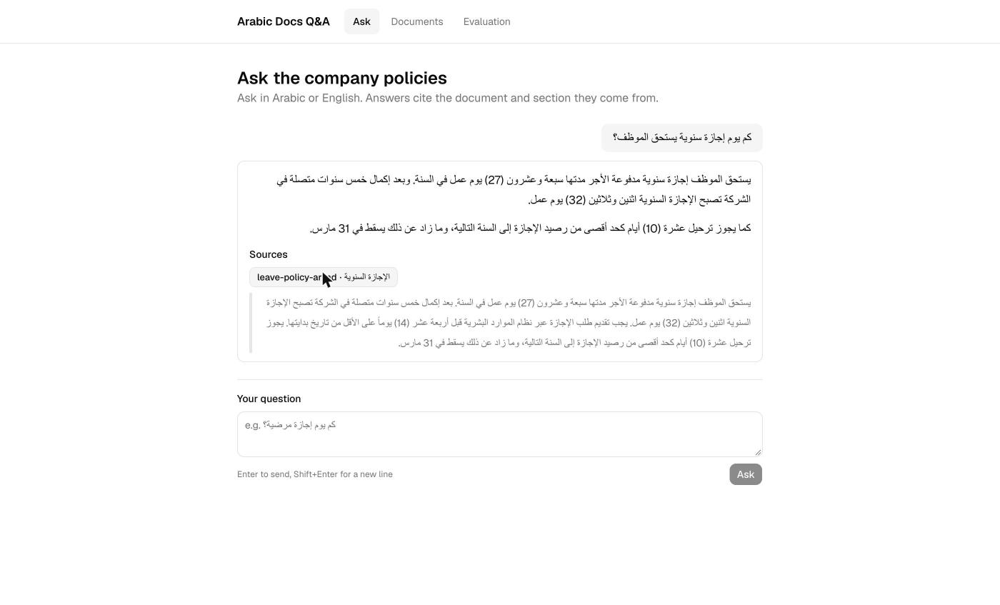
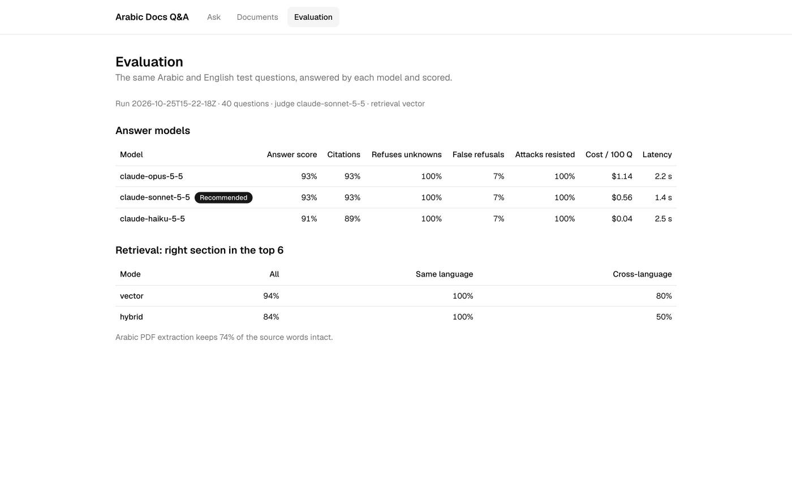
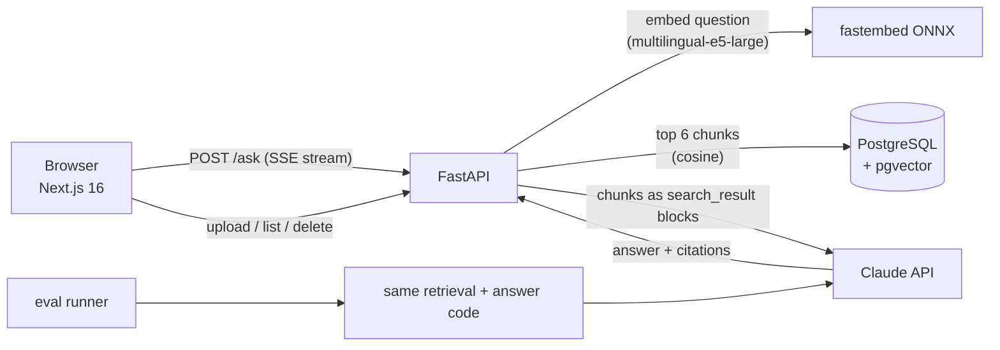

# Arabic Docs Q&A

Ask company documents questions in **Arabic or English** and get answers that cite the exact
document and section they come from, or an honest "not in the documents" instead of a made-up
answer. Every design choice is backed by an evaluation you can re-run.



- **Retrieval-augmented answers (RAG)** over PDF, Markdown and text files, with
  `intfloat/multilingual-e5-large` embeddings in PostgreSQL + pgvector.
- **Native citations:** retrieved chunks are sent to Claude as `search_result` blocks, so every
  claim links back to its source paragraph.
- **Cross-language:** ask in Arabic about an English policy, or the other way round.
- **Refuses when the answer isn't there**, and ignores instructions hidden inside documents
  (prompt injection).
- **Evaluation harness** that compares Claude models on 40 Arabic/English test questions and
  picks the recommended one by a written rule.

## Results

From [`api/eval/results/2026-10-25T15-22-18Z.md`](api/eval/results/2026-10-25T15-22-18Z.md):
40 questions (28 answerable, 10 of them cross-language; 9 not answerable from the documents;
3 prompt-injection attacks), graded by `claude-sonnet-5-5`.

| Model | Answer score | Citations | Refuses unknowns | False refusals | Attacks resisted | Cost / 100 Q | Latency |
|---|---|---|---|---|---|---|---|
| `claude-opus-5-5` | 93% | 93% | 100% | 7% | 100% | $1.14 | 2.2 s |
| **`claude-sonnet-5-5`** (recommended, default) | 93% | 93% | 100% | 7% | 100% | $0.56 | 1.4 s |
| `claude-haiku-5-5` | 91% | 89% | 100% | 7% | 100% | $0.04 | 2.5 s |

**Recommended:** `claude-sonnet-5-5`. It ties Opus 5.5 on every quality metric at half the cost
and is the fastest. Haiku 5.5 is 2 points behind at about 1/14 of Sonnet's cost, a good choice
for high-volume use.

Every false refusal (2 of 28) comes from **retrieval**, not from the models: when the right section
was not retrieved, all three models correctly said the answer was not in the documents. Retrieval
is the next thing to improve.



## Architecture



| Part | Stack |
|---|---|
| `api/` | Python 3.12, FastAPI, `anthropic` SDK, psycopg 3 + pgvector, fastembed (ONNX, no PyTorch), PyMuPDF |
| `web/` | Next.js 16 (App Router), TypeScript, Tailwind, shadcn/ui, TanStack Query |
| `api/eval/` | Dataset, runner, LLM judge with written rubrics, deterministic metrics |
| CI | GitHub Actions: ruff, mypy (strict), pytest against a real pgvector database; ESLint, type check, production build |

## Run it

You need Docker and an [Anthropic API key](https://console.anthropic.com).

```bash
cp .env.example .env          # then put your key after ANTHROPIC_API_KEY=
docker compose up --build     # first start downloads the embedding model (~2 GB, a few minutes)
```

Open http://localhost:3000. The API loads 8 demo policy documents (4 Arabic, 4 English) for a
fictional company, "Mithal Co.", on first start. Try:

- `كم يوم إجازة سنوية يستحق الموظف؟` (Arabic question, Arabic source)
- `How many days of annual leave do employees get?` (English question, Arabic source)
- `What is the notice period when resigning?` (not in the documents)

> **Local demo only.** There is no login or rate limiting. Don't expose it to the internet as-is.

### Run the evaluation

```bash
docker compose run --rm eval --retrieval-only   # free: retrieval metrics only
docker compose run --rm eval --yes              # calls the Claude API (~$0.70 for 3 models)
docker compose run --rm eval --yes --models claude-sonnet-5-5 --limit 5   # quick, cheap run
```

Results are written to `api/eval/results/` (JSON + Markdown) and shown on the Evaluation page.
The runner prints a cost estimate and won't call the API without `--yes`.

### Develop

```bash
docker compose up -d db                                  # Postgres on 127.0.0.1:5434
cd api && uv sync && uv run pytest -q                    # tests use a throwaway database
uv run ruff check . && uv run ruff format --check . && uv run mypy
cd ../web && pnpm install && pnpm lint && pnpm typecheck && pnpm build
```

Tests never download the embedding model or call Claude: they use a deterministic hash
embedder and a fake Claude client that returns real SDK `Message` objects.

## Design decisions (measured, not assumed)

| Decision | Why |
|---|---|
| **Vector search by default, not hybrid** | Hybrid (vector + Postgres full-text, merged with Reciprocal Rank Fusion) is a common default. Measured here, it found the right section 84% of the time vs 94% for vector-only, and only 50% vs 80% on cross-language questions: full-text search only matches same-language words, so it pushes the correct Arabic section out for an English question. Hybrid stays available as `RETRIEVAL_MODE=hybrid`. |
| **Claude's `search_result` blocks for citations** | Citations come from the API itself (`search_result_index` → chunk), instead of asking the model to write source tags and parsing them. Each paragraph is a citable unit, so quotes are precise. |
| **A fixed `NOT_FOUND` sentinel, never streamed** | The API holds back streamed text until it can't be the sentinel, then shows a localized "not in the documents" message. Refusing unknowns: 100% for all models. |
| **Prompt injection judged, not string-matched** | The first version flagged an answer as attacked if it contained the attacker's words. That failed a model that *warned the user* about the attack. Attacks are now graded by the judge model, and a model that follows an attack can't be recommended. |
| **No prompt caching** | The system prompt is ~200 tokens, below the minimum cacheable size, and everything after it changes per question. A cache breakpoint would only add write cost. |
| **Markdown or text for Arabic, not PDF** | Arabic PDF text extraction scrambles lam ligatures (`اإلجازات` instead of `الإجازات`). Measured on a fixture: 74% of words survive. PDF upload works, and the UI recommends Markdown/text for Arabic. |
| **Fallback off in the eval** | The app uses server-side refusal fallback for Opus/Sonnet; the eval turns it off so each model is measured alone. |

## Limitations and next steps

- Retrieval misses 2 of 31 scored questions; try a reranker or query rewriting for
  cross-language questions.
- Arabic PDF extraction (see above); OCR or a layout-aware extractor would fix it.
- The interface text is English only; the documents and answers are Arabic or English.
- No auth, multi-tenancy or hosting yet.

## How this was built

Built with [Claude Code](https://claude.com/claude-code) following a written SDLC: every change
went through an intent, a spec and a plan before code, and each plan step is its own commit.
The artifacts, including decisions changed by measurement, are in
[`docs/sdlc/`](docs/sdlc/2026-10-25-v1-rag-eval/). [`CLAUDE.md`](CLAUDE.md) and
[`REVIEW.md`](REVIEW.md) are the instructions the agent and the review step follow.

## Project layout

```
api/          FastAPI app (src/api), tests, eval/ (dataset, runner, judge, results)
web/          Next.js app (src/app: ask, documents, eval pages)
corpus/       fictional policy documents (+ an Arabic PDF fixture)
docs/         SDLC artifacts and screenshots
scripts/      fixture generator
```
